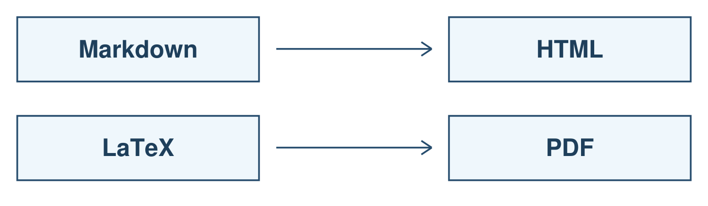
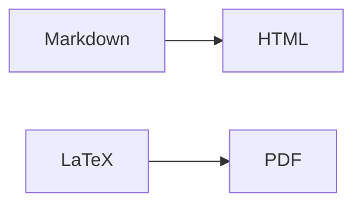

# Семинар 2. Пакеты, open source, Markdown и LaTeX

[Пакеты](#packages) · [Open source](#opensource) · [Markdown](#markdown) · [LaTeX](#latex)

<a name="packages"></a>

## Пакеты

### Модули Python

```python
import sys
print(sys.modules)
```

`sys.modules` — словарь загруженных модулей текущего процесса, а не список установленных пакетов.[1]

```python
before = set(sys.modules.copy())
import fractions

print(sorted(set(sys.modules.copy()) - before))
print(fractions.__file__)
```

Первый `print` выводит модули, загруженные после импорта; второй — путь к исходнику `fractions`.

[Пример: modules.py](examples/modules.py)

### Метаданные пакетов

[Pygments](https://pypi.org/project/Pygments/2.21.0/) — библиотека подсветки синтаксиса.[6]

```python
from importlib.metadata import distribution

package = distribution("Pygments")
print(package.metadata["Name"])
print(package.version)
print(package.requires)
print(package.read_text("METADATA"))
```

`importlib.metadata` читает сведения об установленном дистрибутиве, не импортируя его код. При установке из wheel они хранятся в каталоге `.dist-info`. Имя дистрибутива и имя для `import` могут различаться.[2]

| Поле | Содержание |
|---|---|
| `Name`, `Version` | Название и версия |
| `Requires-Python` | Совместимые версии Python |
| `Requires-Dist` | Зависимости и условия их установки |
| `License-Expression`, `License` | Сведения о лицензии |

Файлы дистрибутива доступны через `package.files`, полный путь — через `package.locate_file(...)`.[2]

[Пример: package_metadata.py](examples/package_metadata.py)

<details>
<summary>Запуск Python-примеров</summary>

Из корня репозитория, Python 3.10+:

```sh
python3 -m venv .venv
source .venv/bin/activate
python -m pip install -r 2026/amcs/grade_1/seminar_2/examples/requirements.txt
python 2026/amcs/grade_1/seminar_2/examples/modules.py
python 2026/amcs/grade_1/seminar_2/examples/package_metadata.py
```

</details>

### Пакетные менеджеры

Менеджер пакетов устанавливает программы и зависимости, учитывает версии и установленные файлы.

| Система | Описание пакета | Установка |
|---|---|---|
| Debian/Ubuntu | `apt show tree` | `sudo apt install tree` |
| Arch Linux | `pacman -Si tree` | `sudo pacman -Syu tree` |
| Homebrew | `brew info tree` | `brew install tree` |

- `apt update` обновляет индекс доступных пакетов, `apt upgrade` — установленное ПО.[16]
- `pacman -Syu tree` включает обновление системы. Частичные обновления вида `pacman -Sy tree` в Arch не поддерживаются.[15]

<a name="opensource"></a>

## Open source

Open source предполагает права использовать, изменять и распространять ПО. Доступный исходник сам по себе этих прав не даёт. [Каталог лицензий OSI](https://opensource.org/licenses).[3]

### MIT и GPL

В [LICENSE этого репозитория](../../../../LICENSE) используется MIT:

- разрешены использование, изменение и распространение, в том числе коммерческие;
- в копиях или существенных частях сохраняются copyright и текст разрешения;
- ПО предоставляется без гарантий, «AS IS».

MIT — permissive-лицензия. GPL — copyleft: при распространении покрытой программы или производной действуют требования GPL, в том числе к предоставлению исходников. Сам запуск GPL-инструмента обычно не распространяет GPL на его результат.[14]

### WTFPL

[Текст WTFPL v2](examples/licenses/WTFPL-2.0.txt) — **Do What The Fuck You Want To Public License**.[13]

FSF признаёт её свободной и совместимой с GPL, но не рекомендует использовать.[7] В стандартном тексте нет отдельного отказа от гарантий; [FAQ автора](https://www.wtfpl.net/faq/) предлагает добавлять его отдельно.[4]

Файл WTFPL здесь — образец лицензии; материалы курса распространяются под MIT.

<a name="markdown"></a>

## Markdown

[Справочник GitHub по Markdown](https://docs.github.com/en/get-started/writing-on-github/getting-started-with-writing-and-formatting-on-github/basic-writing-and-formatting-syntax).[5] [Пример документа](examples/markdown.md).

### Текст и заголовки

```markdown
# Заголовок
## Раздел
### Подраздел

**Жирный текст**, *курсив*, ~~зачёркнутый текст~~.

Новый абзац отделяется пустой строкой.
```

**Жирный текст**, *курсив*, ~~зачёркнутый текст~~.

### Списки

```markdown
- Первый пункт
- Второй пункт

1. Первый пункт
2. Второй пункт

- [x] Выполненный пункт
- [ ] Невыполненный пункт
```

- [x] Выполненный пункт
- [ ] Невыполненный пункт

### Код

Обратные кавычки выделяют `sys.modules` внутри строки. Блок кода ограничивается тремя обратными кавычками; после первых указывается язык:

````markdown
```python
import sys
print(sys.modules)
```
````

### Ссылки и изображения

```markdown
[Исходник отчёта](examples/report.tex)

```

[Исходник отчёта](examples/report.tex) · [PDF](examples/report.pdf)


Относительный путь считается от текущего Markdown-файла.

### Таблицы

```markdown
| Формат | Результат |
|---|---|
| Markdown | HTML |
| LaTeX | PDF |
```

| Формат | Результат |
|---|---|
| Markdown | HTML |
| LaTeX | PDF |

### Раскрывающиеся блоки

```html
<details>
<summary>Заголовок блока</summary>

Содержимое блока.

</details>
```

### Схемы

GitHub поддерживает Mermaid:[12]



### Презентации

[Пример Marp](examples/slides.md): Markdown-слайды с разделителем `---` между слайдами.[9]

<a name="latex"></a>

## LaTeX

### Формулы в GitHub

В Markdown на GitHub формула внутри строки записывается как `$x_i^2$`: $x_i^2$. Отдельная формула ограничивается `$$`.[11]

```latex
\bar{x} = \frac{1}{n}\sum_{i=1}^{n} x_i, \qquad n > 0.
```

$$
\bar{x} = \frac{1}{n}\sum_{i=1}^{n} x_i, \qquad n > 0.
$$

| Исходник | Результат |
|---|---|
| `x_{i+1}` | $x_{i+1}$ |
| `\frac{a}{b}` | $\frac{a}{b}$ |
| `\sum_{i=1}^{n} x_i` | $\sum_{i=1}^{n} x_i$ |
| `\alpha, \beta, \lambda` | $\alpha, \beta, \lambda$ |
| `a \le b` | $a \le b$ |
| `\sqrt{x}` | $\sqrt{x}$ |

Фигурные скобки группируют аргументы. В `x_{i+1}` весь фрагмент `i+1` является индексом. Для текста внутри формулы используется `\text{...}` из `amsmath`.[8]

### Документ

[Полный исходник](examples/report.tex) · [Собранный PDF](examples/report.pdf)

```latex
\documentclass[12pt,a4paper]{article}
\usepackage[T2A]{fontenc}
\usepackage[utf8]{inputenc}
\usepackage[russian]{babel}
\usepackage{amsmath}

\begin{document}
\section{Формула}
Текст и формула $x^2$.
\end{document}
```

- `\documentclass` — класс документа.
- `\usepackage` — подключение пакетов.
- Преамбула — настройки до `\begin{document}`.
- `\begin{...}` и `\end{...}` — границы окружения.
- `%` — комментарий до конца строки.[8]

TeX Live и MiKTeX — дистрибутивы инструментов; pdfLaTeX, XeLaTeX и LuaLaTeX — варианты движка/сборки. [Overleaf](https://www.overleaf.com/learn/latex/Learn_LaTeX_in_30_minutes) — онлайн-среда для редактирования и сборки LaTeX.

GitHub отображает формулы в Markdown, но сам не компилирует `.tex` в PDF.

### Нумерация и ссылки

```latex
\begin{equation}
    p_i = \frac{n_i}{\sum_{j=1}^{k} n_j},
    \qquad \sum_{j=1}^{k} n_j > 0.
    \label{eq:share}
\end{equation}
В формуле~\eqref{eq:share} знаменатель — общее число объектов.
```

`\label` задаёт метку, `\eqref` из `amsmath` подставляет номер формулы. Для обновления ссылок может потребоваться повторная сборка.[8]

### Рисунок

```latex
\begin{figure}[ht]
    \centering
    \includegraphics[width=\linewidth]{workflow.png}
    \caption{Примеры преобразования документов}
    \label{fig:workflow}
\end{figure}
```

Нужен пакет `graphicx`. Ссылка на рисунок: `\ref{fig:workflow}`. Метка ставится после подписи; положение рисунка может выбираться системой.

### Таблица

```latex
\begin{tabular}{ll}
Формат & Результат \\
Markdown & HTML \\
LaTeX & PDF \\
\end{tabular}
```

`&` разделяет столбцы, `\\` завершает строку.

### Сборка

Из каталога `examples/`, с установленным pdfLaTeX:

```sh
pdflatex -interaction=nonstopmode -halt-on-error report.tex
pdflatex -interaction=nonstopmode -halt-on-error report.tex
```

- `??` вместо ссылки — отсутствует метка или нужна повторная сборка.
- `_` в обычном тексте экранируется: `\_`.
- Имена в `\begin{...}` и `\end{...}` должны совпадать.

### HSE TeX

[hse-tex.me](https://hse-tex.me/) — конспекты ПМИ ФКН для первого и второго курсов: линейная алгебра, матанализ, дискретная математика, теория вероятностей.[17]

[Исходники](https://github.com/hse-tex/hse-tex) · [Style guide](https://hse-tex.me/#style-guide)

Из style guide: новый абзац отделяется пустой строкой, а математические операторы записываются командами `\cos`, `\lim` и т. п.[17]

[Материалы Danlark](https://github.com/danlark1/hse_missing_cs_education).[10]

[Все материалы 1 курса](../README.md) · [Домашнее задание 2](../hw_2/README.md)

## Sources

[1] https://docs.python.org/3/library/sys.html
[2] https://docs.python.org/3/library/importlib.metadata.html
[3] https://opensource.org/licenses
[4] https://www.wtfpl.net/faq
[5] https://docs.github.com/en/get-started/writing-on-github/getting-started-with-writing-and-formatting-on-github/basic-writing-and-formatting-syntax
[6] https://pypi.org/project/Pygments/2.21.0
[7] https://www.gnu.org/licenses/license-list.html
[8] https://www.overleaf.com/learn/latex/Learn_LaTeX_in_30_minutes
[9] https://github.com/marp-team/marp-cli
[10] https://github.com/danlark1/hse_missing_cs_education
[11] https://docs.github.com/en/get-started/writing-on-github/working-with-advanced-formatting/writing-mathematical-expressions
[12] https://docs.github.com/en/get-started/writing-on-github/working-with-advanced-formatting/creating-diagrams
[13] https://www.wtfpl.net/txt/copying
[14] https://www.gnu.org/licenses/gpl-faq.html
[15] https://wiki.archlinux.org/title/Pacman
[16] https://manpages.debian.org/trixie/apt/apt.8.en.html
[17] https://hse-tex.me — HSE TeX — конспекты ПМИ ФКН и Style guide
