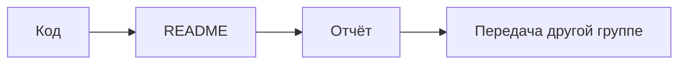

# Семинар 2 · От чужого пакета до понятного проекта

**Весь маршрут семинара — в этом README и соседних файлах этого репозитория.** Локально преподаватель показывает только пакеты и их метаданные. Markdown и формулы смотрим прямо в GitHub; полный LaTeX-документ представлен исходником и готовым PDF. Обязательных переходов в Overleaf, отдельные сервисы или другие учебные репозитории нет.

История занятия: мы хотим передать небольшой учебный проект другой группе. Для этого недостаточно исходника: нужно понимать инструменты и разрешения, написать инструкцию и оформить объяснение решения.

## Маршрут

Расчёт на **90 минут**. Если пара другой длины, сохраняем пропорции: пакеты — 10%, open source — 10–15%, остальное — Markdown, LaTeX и проверка документов.

| Время | Тема | Что показываем |
|---|---|---|
| 00–09 | [Пакеты и метаданные](#packages) · 10% | Локально: `sys.modules`, импорт, `METADATA` |
| 09–21 | [Open source и лицензии](#opensource) · около 13% | LICENSE этого репозитория, WTFPL как контрпример |
| 21–48 | [Markdown](#markdown) · 30% | Этот README: текст, код, таблицы, изображения, формулы |
| 48–84 | [LaTeX](#latex) · 40% | Формулы на GitHub, полный `.tex` и готовый PDF рядом |
| 84–90 | [Практика и взаимная проверка](#practice) · около 7% | Проверяем, понятна ли работа без устных подсказок |

## Файлы, которые пригодятся

- [Кэш модулей Python](examples/modules.py) — локальная демонстрация.
- [Чтение метаданных дистрибутива](examples/package_metadata.py) — локальная демонстрация.
- [Небольшой Markdown-документ](examples/markdown.md) — сравнить исходник и отображение.
- **[Исходник отчёта `report.tex`](examples/report.tex) ↔ [собранный `report.pdf`](examples/report.pdf)** — сравнить команды и результат, не выходя из GitHub.
- [Пример WTFPL](examples/licenses/WTFPL-2.0.txt) — только образец для обсуждения, не лицензия курса.
- [Marp: три слайда из Markdown](examples/slides.md) — необязательный бонус, не отдельная обязательная тема.

<a name="packages"></a>

## 1. Пакеты и метаданные · 9 минут

**Вопрос:** когда мы пишем `import`, откуда берётся код и кто знает, какая версия установлена?

### Сначала — `print(sys.modules)`

В локальном Python 3:

```python
import sys
print(sys.modules)
```

`sys.modules` — словарь уже загруженных модулей текущего процесса: имя → объект модуля. **Это не список всех установленных пакетов.** Модуль может быть установлен, но ещё не импортирован. И наоборот: в словаре есть встроенные модули и стандартная библиотека, для которых мы не делали `pip install`.[1]

Посмотрим, что меняет один импорт:

```python
before = set(sys.modules.copy())
import fractions

print(sorted(set(sys.modules.copy()) - before))
print(fractions.__file__)
```

Набор новых модулей зависит от версии Python и того, что уже загружено. Не нужно запоминать конкретное количество. Готовый повторяемый пример — [modules.py](examples/modules.py).

### Где лежат сведения об установленном пакете

Для демонстрации берём Pygments. Это библиотека подсветки синтаксиса; её заранее устанавливаем в отдельное виртуальное окружение. Для чтения остального семинара установка не нужна.[6]

```python
from importlib.metadata import distribution

package = distribution("Pygments")
print(package.metadata["Name"])
print(package.version)
print(package.requires)
print(package.read_text("METADATA"))
```

Так можно прочитать метаданные установленного **дистрибутива**, не импортируя код самого Pygments. В типичной установке из wheel они находятся в каталоге вида `pygments-<версия>.dist-info/`. Посмотреть реальные пути можно через `package.files` и `package.locate_file(...)`.[2]

Готовый [package_metadata.py](examples/package_metadata.py) показывает путь к `METADATA` и его заголовки до длинного описания проекта.

| Поле | Что ищем |
|---|---|
| `Name`, `Version` | Как называется дистрибутив и какая версия установлена |
| `Requires-Python` | Какие версии Python подходят |
| `Requires-Dist` | Объявленные зависимости, в том числе условные/опциональные |
| `License-Expression` или `License` | Сведения о лицензии; наличие конкретного поля зависит от пакета и формата метаданных |

Имя дистрибутива для установки и имя для `import` могут отличаться. Метаданные — полезная точка входа, но полный текст лицензии и условия заимствования нужно проверять отдельно.[2]

<details>
<summary>Подготовить локальную демонстрацию заранее</summary>

Из корня репозитория, с Python 3.10+:

```sh
python3 -m venv .venv
source .venv/bin/activate
python -m pip install -r 2026/amcs/grade_1/seminar_2/examples/requirements.txt
python 2026/amcs/grade_1/seminar_2/examples/modules.py
python 2026/amcs/grade_1/seminar_2/examples/package_metadata.py
```

В Windows окружение активируется иначе; для самого семинара достаточно показа преподавателя. Не нужно ставить новый Python или менеджер пакетов посреди занятия.

</details>

### Что делает пакетный менеджер

Найти пакет → выбрать версию → разобрать зависимости → получить и проверить файлы → установить → вести учёт установленного. Проверки целостности или подписи не означают, что программа доказанно безопасна.

| Контекст | Посмотреть описание | Установить |
|---|---|---|
| Debian/Ubuntu | `apt show tree` | `sudo apt install tree` |
| Arch Linux | `pacman -Si tree` | `sudo pacman -Syu tree` — может обновить всю систему |
| Homebrew | `brew info tree` | `brew install tree` |

На занятии достаточно одного подходящего менеджера, а не всех трёх. У APT `update` обновляет сведения о пакетах, а `upgrade` — установленное ПО.[16] В Arch нельзя бездумно подменять полное обновление частичным `pacman -Sy ...`.[15] Большие обновления готовим заранее.

**Переход:** «Мы увидели, что пакет имеет автора, версию и лицензию. Технически получить код получилось. А что нам разрешено с ним делать?»

<a name="opensource"></a>

## 2. Open source и лицензии · 12 минут

### Видимый код, бесплатное ПО и open source — не синонимы

Open source — не просто возможность открыть исходник в браузере. Важны права использовать, изменять и распространять программу и условия этих прав. На [opensource.org/licenses](https://opensource.org/licenses) находится каталог лицензий, одобренных Open Source Initiative. Он полезен как справочник; для разбора на семинаре достаточно примеров в этом репозитории.[3]

### Разбираем настоящий LICENSE

Открываем **[LICENSE нашего репозитория](../../../../LICENSE)**. Здесь уже выбрана MIT; в этом занятии её не меняем.

Найдите три части:

1. **Разрешение:** использовать, копировать, изменять, распространять, в том числе продавать копии.
2. **Условие:** сохранить copyright и текст разрешения в копиях или существенных частях.
3. **Отказ от гарантий:** работа предоставляется «AS IS»; это не обещание качества и отсутствия ошибок.

Одна короткая лицензия уже отвечает на больше вопросов, чем «ну это же лежит на GitHub».

Для ориентира: permissive-лицензии вроде MIT допускают закрытые производные при соблюдении условий. Copyleft-лицензии вроде GPL добавляют условия при распространении покрытой программы/производной. **Сам запуск GPL-инструмента не равен включению его кода в свою программу.** Для конкретного заимствования важны текст и версия лицензии, исключения и способ распространения.[14]

### WTFPL: смешное название не заменяет выбор условий

Открываем [полный текст WTFPL v2](examples/licenses/WTFPL-2.0.txt). Название — **Do What The Fuck You Want To Public License**; единственный пункт выглядит нарочито коротко.[13]

Почему для обычного учебного или рабочего проекта разумнее выбрать более привычную лицензию:

- FSF описывает WTFPL как свободную permissive-лицензию, совместимую с GPL, **но не рекомендует её**.[7]
- В стандартном тексте нет отдельного отказа от гарантий; FAQ автора прямо это обсуждает и предлагает добавлять такой текст отдельно.[4]
- Название «делай что хочешь» не объясняет все вопросы, которые могут быть важны автору и пользователям. Если нужны определённые условия, выбираем их осознанно, а не по длине или шутке в названии.

Это **не** утверждение, что WTFPL «незаконна» или вообще не является лицензией. И это не новая лицензия курса: файл включён как пример для чтения.

### Три вопроса на обсуждение

1. Скопировали MIT-фрагмент в проект, который передаём другим. Что нужно сохранить?
2. Нашли публичный репозиторий без лицензии. Достаточно ли публичности, чтобы свободно копировать код?
3. Сделали собственный документ GPL-инструментом. Обязан ли документ из-за этого стать GPL?

<details>
<summary>Короткие ответы</summary>

1. Уведомление об авторских правах и текст разрешения; свою LICENSE не выдаём за отмену чужих условий.
2. Нет. Публичность репозитория сама по себе не даёт произвольных прав на код.
3. Обычно нет. Запуск инструмента и включение защищённых частей его кода/шаблонов в результат — разные ситуации.

Это учебное объяснение, не юридическое заключение.

</details>

**Переход:** «Теперь понятно, что разрешено передавать. Но получатель не телепат. Как объяснить ему, что мы передали и как этим пользоваться?»

<a name="markdown"></a>

## 3. Markdown · 27 минут

**Этот README и есть демонстрационный материал.** Сравнивайте отображение файла с его исходником в GitHub. Рядом есть более короткий [пример](examples/markdown.md), в котором удобно пробовать изменения. Официальный [GitHub guideline по Markdown](https://docs.github.com/en/get-started/writing-on-github/getting-started-with-writing-and-formatting-on-github/basic-writing-and-formatting-syntax) — справочник, а не обязательный отдельный сайт для выполнения задания.[5]

### Структура важнее оформления

````markdown
# Название проекта

Коротко: что делает проект и для кого.

## Требования
- Какие нужны инструменты.
- На каком окружении проверяли.

## Запуск
```sh
python3 main.py --help
```

## Пример результата
По чему пользователь поймёт, что всё сработало.
````

Это пример синтаксиса, а не обещание, что в репозитории есть `main.py`. В README своего настоящего проекта пишем только проверенную команду.

### Минимальный синтаксис

| Исходник | Результат |
|---|---|
| `**важно**` | **важно** |
| `*акцент*` | *акцент* |
| `~~устарело~~` | ~~устарело~~ |
| `` `sys.modules` `` | `sys.modules` |
| `- пункт` | Маркированный список |
| `[текст](адрес)` | Ссылка |

Пустая строка разделяет абзацы. Не рассчитывайте, что любой одиночный перевод строки в исходнике станет видимым переводом строки в результате.[5]

### Ссылки и изображения

```markdown
[Исходник отчёта](examples/report.tex)

```

[Исходник отчёта](examples/report.tex)


Относительные пути удобны внутри репозитория. Путь считается **от текущего файла**, а не от корня проекта. При перемещении файла ссылки нужно проверить заново. Alt-текст изображения объясняет его смысл, а не только имя файла.

### Код — не обычный абзац

Три обратные кавычки открывают и закрывают блок кода; после первых можно указать язык для подсветки:

````markdown
```python
import sys
print(sys.modules)
```
````

Это особенно важно для отступов в Python и для команд, которые человек захочет скопировать.

### Таблицы, чек-листы и скрытые ответы

```markdown
| Файл | Назначение |
|---|---|
| README.md | Инструкция |
| report.tex | Исходник отчёта |

- [x] Описано назначение
- [ ] Проверена команда запуска
```

- [x] Описано назначение
- [ ] Проверена команда запуска

Скрытый разбор удобно оформить так:

```html
<details>
<summary>Показать ответ</summary>

Текст ответа. Пустые строки помогают не сломать разметку.

</details>
```

Это уже возможности конкретной среды. Не всё, что умеет GitHub, одинаково работает в любом Markdown-редакторе.[5]

### Формулы и схемы прямо в GitHub

В GitHub можно писать математические выражения в LaTeX-подобном синтаксисе. Например, `$x_i^2$` отображается как $x_i^2$. Для отдельной формулы используем `$$`.[11]

$$
p_i = \frac{n_i}{\sum_{j=1}^{k}n_j}, \qquad \sum_{j=1}^{k}n_j > 0.
$$

Для схем есть, например, Mermaid:[12]



Mermaid — дополнительная возможность GitHub, а не обязательная часть базового Markdown.

### Небольшая практика

На основе [examples/markdown.md](examples/markdown.md) подготовьте паспорт знакомого учебного проекта:

- назначение в двух предложениях;
- требования;
- реальный запуск и ожидаемое поведение;
- одна ссылка, блок кода и чек-лист;
- одна формула или небольшая схема, если она помогает объяснению.

Для изменений нужна своя ветка с правом записи или fork; для чтения и демонстрации этого не требуется. Не публикуйте токены и личные файлы. Один общий README лучше пяти сообщений «а ещё надо установить вот это».

**Переход:** «Для инструкции Markdown удобен. Но если нужно оформить полноценный математический текст, формулы с номерами, рисунок и ссылки на них — посмотрим на LaTeX».

<a name="latex"></a>

## 4. LaTeX · 36 минут

### Сначала формулы, не установка TeX

Для формул мы уже используем часть математического синтаксиса LaTeX внутри GitHub. Полный LaTeX-документ — другой уровень: у него есть класс, преамбула, пакеты, тело документа и процесс сборки.[8]

**Граница возможностей:** GitHub отображает математические выражения в Markdown, но не компилирует произвольный `.tex` в PDF сам по себе. Поэтому рядом лежат **[проверенный исходник](examples/report.tex)** и **[его собранный результат](examples/report.pdf)**. На семинаре оба открываются здесь, в одном репозитории. Отдельный сервис не обязателен.

### HSE TeX: реальные конспекты ПМИ

**[hse-tex.me](https://hse-tex.me/)** — коллекция затеханных учебных материалов для ПМИ ФКН НИУ ВШЭ: на сайте есть материалы первого и второго курсов, в том числе по линейной алгебре, математическому анализу, дискретной математике и теории вероятностей.[17]

Это **не редактор и не ещё один компилятор**, а пример того, ради чего вообще учить LaTeX: большой математический текст можно хранить в исходниках, исправлять совместно и публиковать в PDF. Исходники проекта доступны в [GitHub-репозитории HSE TeX](https://github.com/hse-tex/hse-tex); на сайте предлагают сообщать об опечатках через issue или присылать исправления pull request’ом.[17]

В [Style guide HSE TeX](https://hse-tex.me/#style-guide) есть практические советы:

- новый абзац лучше отделять пустой строкой, а не командой `\\`;
- математические операторы писать командами, например `\cos` и `\lim`, а не обычными буквами;
- придерживаться единого стиля исходника, чтобы разные части документа было удобно читать и менять.[17]

**Как использовать:** подсмотреть устройство большого документа и оформление конспекта, свериться с определением или найти пример записи. Проверяйте год, автора и соответствие своей программе: наличие материала на сайте не означает, что он точно совпадает с вашим курсом 2026 года.

На семинаре это дополнительный реальный пример. Основной разбор остаётся здесь: [наш `.tex`](examples/report.tex) и [наш готовый PDF](examples/report.pdf), поэтому переход на внешний сайт не обязателен.

### Самые полезные математические конструкции

| Исходник | Смысл |
|---|---|
| `x_i`, `x^2`, `x_{i+1}` | Индексы и степени |
| `\frac{a}{b}` | Дробь |
| `\sum_{i=1}^{n} x_i` | Сумма |
| `\alpha`, `\beta`, `\lambda` | Греческие буквы |
| `\le`, `\ge`, `\ne` | Сравнения |
| `\sqrt{x}` | Корень |

$$
\bar{x} = \frac{1}{n}\sum_{i=1}^{n}x_i, \qquad n>0.
$$

```latex
\bar{x} = \frac{1}{n}\sum_{i=1}^{n}x_i, \qquad n>0.
```

Фигурные скобки группируют аргументы. В `x_{i+1}` индексом становится всё `i+1`, а не только следующая буква. Для обычного текста внутри формулы нужен, например, `\text{...}` из `amsmath`.[8]

### Из чего состоит документ

```latex
\documentclass[12pt,a4paper]{article}
% Здесь преамбула: пакеты, язык, настройки.

\begin{document}
\section{Задача}
Здесь текст документа.
\end{document}
```

- `\documentclass` выбирает класс документа.
- `\usepackage` подключает дополнительные возможности.
- Всё до `\begin{document}` — преамбула.
- Команды начинаются с `\`, окружения имеют `\begin{...}` и `\end{...}`.
- `%` начинает комментарий до конца строки.[8]

Различайте **LaTeX** как систему подготовки документа, **TeX Live/MiKTeX** как дистрибутивы инструментов и **pdfLaTeX/XeLaTeX/LuaLaTeX** как разные варианты движка/сборки. Overleaf — одна из сред для работы с LaTeX, но не сам язык и не обязательный шаг нашего семинара.

### Формула, метка и ссылка

Фрагмент из [report.tex](examples/report.tex):

```latex
\begin{equation}
    p_i = \frac{n_i}{\sum_{j=1}^{k} n_j},
    \qquad \sum_{j=1}^{k} n_j > 0.
    \label{eq:share}
\end{equation}
В формуле~\eqref{eq:share} знаменатель — общее число объектов.
```

`\label` даёт смысловое имя, `\eqref` из `amsmath` подставляет актуальный номер. В PDF не нужно вручную писать «формула 1». После изменений может понадобиться повторная сборка для обновления ссылок.[8]

### Рисунок и таблица

В примере отчёта рисунок подключается из того же каталога:

```latex
\begin{figure}[ht]
    \centering
    \includegraphics[width=\linewidth]{workflow.png}
    \caption{От исходника к понятному результату}
    \label{fig:workflow}
\end{figure}
```

Позиция рисунка может подбираться системой. У него есть подпись и метка; на рисунок ссылаются через `\ref{fig:workflow}`. Это описание структуры, а не обещание координат «поставить ровно сюда».

В таблице `&` разделяет столбцы, `\\` завершает строку:

```latex
\begin{tabular}{ll}
Файл & Назначение \\
README.md & Инструкция \\
report.tex & Исходник отчёта \\
\end{tabular}
```

### Что происходит при сборке

Для нашего русскоязычного шаблона выбран pdfLaTeX. Если совместимый TeX уже установлен, команды запускаются **из каталога `examples/`**, где лежит и картинка:

```sh
pdflatex -interaction=nonstopmode -halt-on-error report.tex
pdflatex -interaction=nonstopmode -halt-on-error report.tex
```

Это необязательное продолжение вне занятия. На самом семинаре достаточно сравнить исходник и готовый PDF в GitHub. Не нужно запускать установку большого TeX-дистрибутива.

### Частые ошибки

- Не закрыли `{}` или `\end{...}` — начать с первой ошибки, а не с последних последствий.
- Перепутали математический режим и обычный текст: `_` в имени файла нужно экранировать или оформить подходящей командой.
- Получили `??` вместо ссылки — проверить имя метки, отсутствие ошибок и повторно собрать.
- Изменили движок, но оставили несовместимую преамбулу — вернуться к проверенному сочетанию.
- Старый PDF открылся, хотя новая сборка упала — проверять статус сборки, не только наличие файла.

<a name="practice"></a>

## 5. Практика и проверка · последние 6 минут

### Минимум, который можно сделать прямо в GitHub

В своей копии [Markdown-примера](examples/markdown.md):

1. Замените описание на знакомый учебный проект.
2. Добавьте формулу с индексом, дробью и суммой; объясните переменные обычным текстом.
3. Сравните [report.tex](examples/report.tex) и [report.pdf](examples/report.pdf): найдите, какая команда породила заголовок, формулу, номер и рисунок.
4. Объясните соседу разницу между формулой в Markdown и полным LaTeX-документом.

Если захотите изменить `.tex`, сделайте это в своей копии. GitHub сам не пересоберёт PDF — изменённый исходник нужно отдельно собрать совместимым инструментом. Не выдавайте старый PDF за результат нового исходника.

### Чек-лист получателя

- [ ] Я понимаю назначение проекта и требования.
- [ ] Есть реальная, проверенная инструкция запуска.
- [ ] Понятно, что разрешено использовать и какие уведомления сохранить.
- [ ] Формула сопровождается объяснением, а не вставлена для красоты.
- [ ] Я различаю Markdown, математическую разметку и полный LaTeX-документ.
- [ ] Я могу назвать одну конкретную правку, которая сделает передачу проекта проще.

<details>
<summary>Необязательный бонус: презентация из того же Markdown</summary>

[Marp](examples/slides.md) позволяет описать слайды текстом: настройки в начале, разделитель `---` между слайдами. Это не требует заново раскладывать весь текст мышкой. Для этого занятия достаточно посмотреть исходник; установка и экспорт не обязательны.[9]

</details>

## Что почитать дальше

- [Официальный GitHub guideline: что умеет Markdown](https://docs.github.com/en/get-started/writing-on-github/getting-started-with-writing-and-formatting-on-github/basic-writing-and-formatting-syntax).
- [Официальный учебник Overleaf по LaTeX](https://www.overleaf.com/learn/latex/Learn_LaTeX_in_30_minutes).
- [Каталог лицензий OSI](https://opensource.org/licenses).
- [Материалы Danlark, на которые опирается семинар](https://github.com/danlark1/hse_missing_cs_education).[10]

[Все материалы 1 курса](../README.md) · [Домашнее задание 2](../hw_2/README.md)

## Sources

[1] https://docs.python.org/3/library/sys.html
[2] https://docs.python.org/3/library/importlib.metadata.html
[3] https://opensource.org/licenses
[4] https://www.wtfpl.net/faq
[5] https://docs.github.com/en/get-started/writing-on-github/getting-started-with-writing-and-formatting-on-github/basic-writing-and-formatting-syntax
[6] https://pypi.org/project/Pygments/2.21.0
[7] https://www.gnu.org/licenses/license-list.html
[8] https://www.overleaf.com/learn/latex/Learn_LaTeX_in_30_minutes
[9] https://github.com/marp-team/marp-cli
[10] https://github.com/danlark1/hse_missing_cs_education
[11] https://docs.github.com/en/get-started/writing-on-github/working-with-advanced-formatting/writing-mathematical-expressions
[12] https://docs.github.com/en/get-started/writing-on-github/working-with-advanced-formatting/creating-diagrams
[13] https://www.wtfpl.net/txt/copying
[14] https://www.gnu.org/licenses/gpl-faq.html
[15] https://wiki.archlinux.org/title/Pacman
[16] https://manpages.debian.org/trixie/apt/apt.8.en.html
[17] https://hse-tex.me — HSE TeX — конспекты ПМИ ФКН и Style guide
