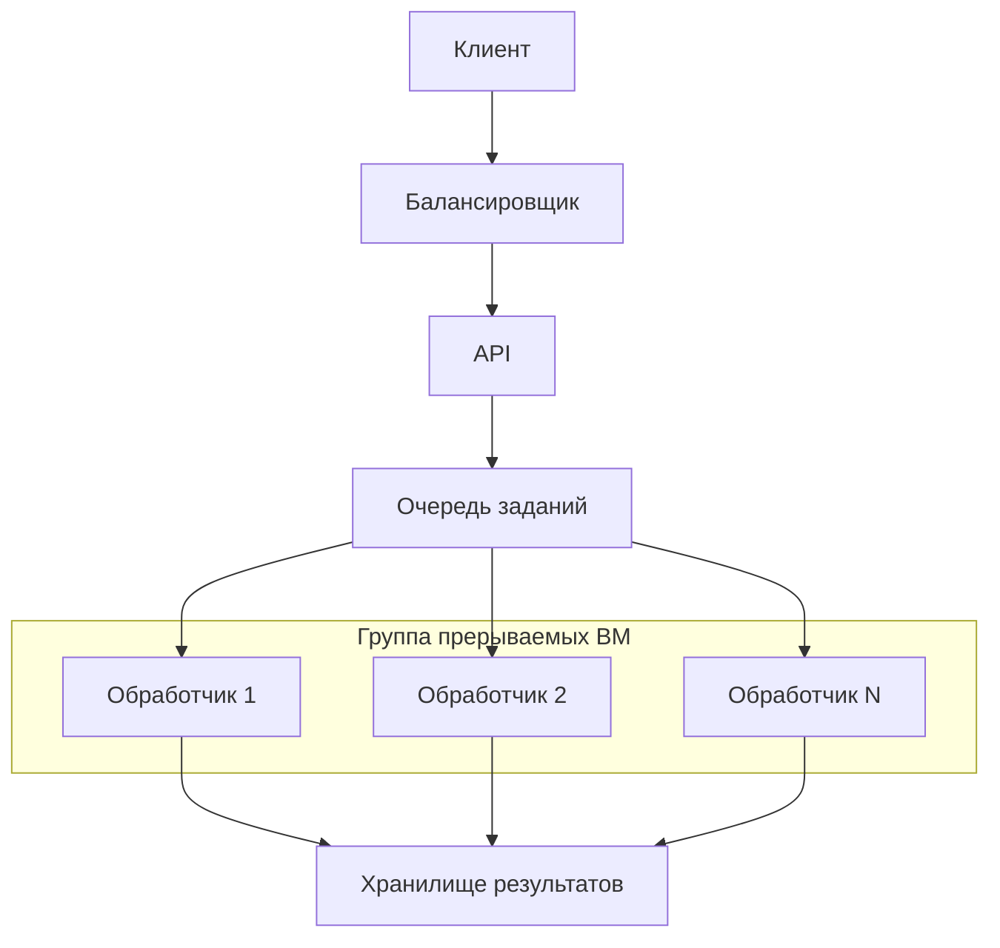

# ДЗ-4: облака

Вам предстоит разобраться в том как на практике работать с облачными ресурсами.

# Откуда взять ресурсы?

<aside>

> **Перед началом курса мы смогли договориться о достаточно большом гранте в Яндекс Облаке. Но ввиду недавних событий этого гранта больше нет. Поэтому приходится полагаться на вас и просить вас пойти нам навстречу.**
> 
</aside>

Для того, что бы получить ресурсы вам нужно воспользоваться вступительным грантом в доступном облаке. Я подготовил подборку облачных провайдеров, которые должны быть доступны подавляющему числу студентов

- [Яндекс Облако](https://yandex.cloud/ru/docs/getting-started/usage-grant)
- [Cloud(aka SberCloud)](https://cloud.ru/docs/billing/ug/topics/concepts__start_grant)
- [VK Cloud](https://land.vkcloud-static.ru/bonus/)
- [MTS Cloud](https://mws.ru/docs/cloud-platform/billing/general/welcome-grant.html)

<aside>

> Если не один из вариантов вам не подходит, то напишите лично лектору и ваш вопрос будет решаться.
> 
</aside>

Обратите внимание, что ресурсов в тестовом гранте мало и следите, что бы вы не вышли за лимиты.

Надеюсь на ваше понимание.

## Оценивание

Для того, что бы выполнить пункт на оценку X нужно выполнить все пункты с оценкой меньше X.

| Оценка | Результат |
| --- | --- |
| 4 | Аккаунт облачного провайдера и вход в консоль |
| 6 | Собственная сеть, подсеть и работающая ВМ |
| 8 | Балансировщик и  две ВМ; ВМ не должно быть доступно из вне, только через балансировщик |
| 10 | Приём заданий через балансировщик, очередь и группа прерываемых ВМ с автомасштабированием по нагрузке очереди |

### Дополнительные баллы за Terraform

За каждый полностью выполненный уровень на 6, 8 и 10 баллов можно получить **по +1 баллу**, если инфраструктура соответствующего уровня создана с помощью Terraform.

| Уровень | Что должно создаваться через Terraform | Бонус |
| --- | --- | --- |
| 6 | Сеть, подсеть, ВМ и её группы безопасности | +1 |
| 8 | Балансировщик со связанными ресурсами, backend-ВМ и правила доступа | +1 |
| 10 | Очередь, группа прерываемых ВМ, политика автомасштабирования и необходимые сервисные аккаунты/права | +1 |

Для бонуса приложите использованные `.tf`-файлы, необходимые шаблоны запуска ВМ и README с командами `terraform init`, `terraform plan`, `terraform apply` и `terraform destroy`. Конфигурация должна воспроизводить реально созданную инфраструктуру после задания параметров и учётных данных. Учётные записи, платёжный аккаунт и первоначальную настройку доступа автоматизировать не требуется.

## 4 балла — зарегистрироваться в облаке

1. Зарегистрируйтесь в провайдере
2. Войдите в его консоль управления

Если аккаунт уже есть, можно использовать его

**Сдать:** один скриншот консоли Yandex Cloud после входа

## 6 баллов — создать ВМ и сеть

1. Создайте собственную виртуальную сеть в Yandex Virtual Private Cloud
2. Создайте в ней подсеть
3. Создайте Linux-ВМ в Yandex Compute Cloud и подключите её к этой подсети. Выберите небольшую конфигурацию.
4. Подключитесь к ВМ по SSH и выполните:

```bash
hostname
ip -brief address
```

**Сдать:**

- Скриншоты сети, подсети и ВМ с видимой привязкой к подсети.
- Результат подключения и выполнения команд.
- Кратко указать: диапазон подсети, внутренний IP ВМ и, если назначен, внешний IP.

## 8 баллов — ВМ за балансировщиком

1. Разверните минимум две ВМ с простым HTTP-сервисом. Можно использовать Nginx или небольшой сервер на любом языке. Пример будет доступен по ссылке ниже
2. Ответ каждой ВМ должен содержать её имя или другой уникальный идентификатор. Например: `Hello from vm-1` и `Hello from vm-2`
3. Создайте внешний балансировщик и подключите к нему обе ВМ
4. Настройте проверки работоспособности — health checks
5. Обеспечьте доступ к приложению только через балансировщик

**Проверить и показать:**

1. Несколько запросов на адрес балансировщика дают ответы от обеих ВМ
2. После остановки сервиса на одной ВМ и срабатывания health checks новые запросы обслуживаются оставшейся ВМ.
3. Прямой доступ к приложению в обход балансировщика закрыт: покажите отсутствие публичных IP, сетевые правила и неуспешную попытку подключения к прикладному порту из другой ВМ сети, которой такой доступ не разрешён

**Сдать:** схему инфраструктуры, настройки доступа и подтверждения трёх проверок. После записи доказательств ресурсы можно удалить

**Критерий:** один сервер за балансировщиком, балансировщик без health checks или открытый прямой доступ к приложению не закрывают уровень на 8.

## 10 баллов — очередь и автомасштабирование прерываемых ВМ

### Архитектура



### Что реализовать

1. **API**. С помощью serverless функций
2. **Очередь.** Создайте очередь. Доступ к отправке и получению сообщений должен требовать авторизации
3. **Обработчики.** Создайте группу в Compute Cloud Instance Groups с прерываемыми ВМ в шаблоне. Каждая ВМ получает задания из очереди и обрабатывает их. Новые ВМ должны запускать обработчик автоматически: через образ, cloud-init, startup script или аналог
4. **Результат.** Сохраняйте результат на внешнее от ВМ хранилище, например в объектном хранилище(рекомендуется) или БД. Для каждого задания должны быть видны `task_id`, идентификатор обработчика и итог выполнения
5. **Автомасштабирование.** Настройте в Compute Cloud Instance Groups автоматическое увеличение и уменьшение числа обработчиков по метрике заполнения очереди. Для демонстрации используйте минимум 1 и максимум 3 ВМ. Подберите порог и периоды измерения/стабилизации так, чтобы рост и последующее уменьшение были наблюдаемы
6. **Обработка сбоев.** Подтверждайте сообщение или удаляйте его из очереди только после успешной обработки и сохранения результата. Если обработчик прервался до подтверждения, задание должно стать доступным для повторной обработки. Повторная доставка не должна создавать несколько итоговых результатов для одного `task_id`

### Обязательная демонстрация

1. Покажите группу из одной worker-ВМ и пустую очередь
2. Отправьте через балансировщик достаточно заданий, чтобы образовалась очередь
3. Покажите, что группа автоматически выросла хотя бы до двух ВМ и задания выполнялись несколькими обработчиками
4. Дождитесь завершения заданий и автоматического уменьшения группы до одной ВМ. Не меняйте размер группы вручную во время этой проверки
5. Отдельно покажите восстановление после потери worker-ВМ: прервите её во время незавершённой задачи. Группа должна восстановить требуемую численность, а неподтверждённое задание — успешно выполниться после повторной доставки

**Сдать:**

- **Видео с процессом работы**
- Графики или последовательность скриншотов с общими временными отметками: нагрузка очереди и количество ВМ
- Примеры результатов и подтверждение повторного выполнения задания после сбоя

## Как сдавать

На 4 достаточно скриншота(-ов). Для остальных уровней сдайте короткий отчёт в Markdown или PDF: ФИО, ожидаемое кол-во баллов, ожидаемые Terraform-бонусы, выполненные шаги и доказательства проверок. Код и конфигурацию приложите архивом или ссылкой на репозиторий

Используйте минимальные конфигурации и оповещение о расходах. После демонстрации удалите ненужные ресурсы, включая балансировщик, NAT, ВМ, диски, образы и зарезервированные IP.

#### Докер образы для 8 и 10 баллов

Для получения нужных образов выполните команды рядом с ними

| Сервис | Команда |
| --- | --- |
| web приложение(8 баллов) | docker pull cr.yandex/crpnt321eg8cp4nfqpo0/cloud-hw4-api:sha256:156cea274a4cd33b83021f6591b0e46c98a821364facebebea4b8ea8f7e6e11d |
| worker(10 баллов) | docker pull cr.yandex/crpnt321eg8cp4nfqpo0/cloud-hw4-worker:sha256:90bd82f6d9472e3525ab20e3647315988ef89cb1741517bcd5b3952cee479733 |
| API(10 баллов) | cr.yandex/crpnt321eg8cp4nfqpo0/cloud-hw4-api:sha256:156cea274a4cd33b83021f6591b0e46c98a821364facebebea4b8ea8f7e6e11d |
| Генератор нагрузки(10 баллов) | docker pull cr.yandex/crpnt321eg8cp4nfqpo0/cloud-hw4-load:sha256:f500f8b8b3af6100f0d620161b1601d71ebdf2f07cbc09d8e440355522c5fbdc |
