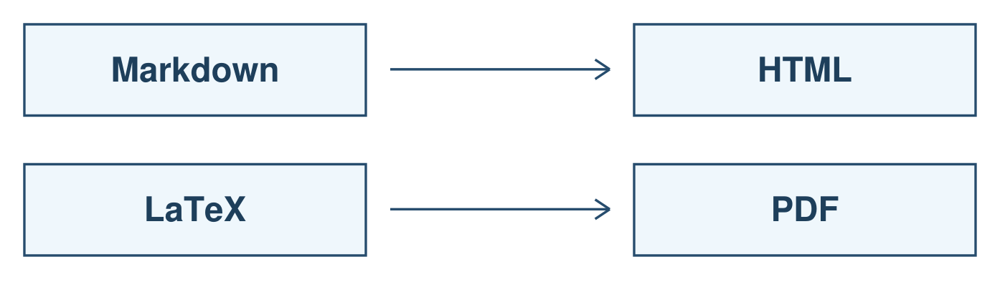
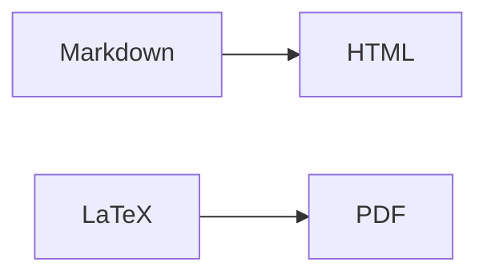

# Семинар 2: пакеты, open source, Markdown и LaTeX

[Конспект семинара (PDF)](missing_semester_seminar_2.pdf)

[Пакеты](#packages) · [Open source](#opensource) · [Markdown](#markdown) · [LaTeX](#latex)

<a name="packages"></a>

## Пакеты

### Модули Python

```python
import sys
print(sys.modules)
```

[`sys.modules`][python-modules] содержит загруженные модули текущего процесса, а не все установленные пакеты

```python
before = set(sys.modules.copy())
import fractions

print(sorted(set(sys.modules.copy()) - before))
print(fractions.__file__)
```

Первый `print` выводит новые модули после импорта
Второй выводит путь к исходнику `fractions`

[Пример: modules.py](examples/modules.py)

### Метаданные пакетов

Пример с [Pygments][pygments], библиотекой подсветки синтаксиса

```sh
python3 -m venv .venv
source .venv/bin/activate
python -m pip install Pygments==2.21.0
python -m pip show -f Pygments
```

Путь к каталогу `.dist-info` без привязки к версии Python и расположению окружения

```sh
DIST_INFO="$(python -c 'from importlib.metadata import distribution; d = distribution("Pygments"); print(d.locate_file(next(p for p in d.files if str(p).endswith(".dist-info/METADATA"))).parent)')"
printf '%s\n' "$DIST_INFO"
```

Файлы можно открыть через `less`, выход по `q`

```sh
less "$DIST_INFO/METADATA"
less "$DIST_INFO/RECORD"
less "$DIST_INFO/licenses/LICENSE"
```

| Файл | Что внутри |
|---|---|
| `METADATA` | Версия, название, зависимости, сведения о лицензии |
| `RECORD` | Пути установленных файлов, их хеши и размеры |
| `licenses/LICENSE` | Полный текст лицензии Pygments |

В `METADATA` интересны поля `Name`, `Version`, `Requires-Python`, `Requires-Dist`, `License-Expression`

Хеши находятся в `RECORD`, а не в `METADATA`
Хеш `sha256=...` в `RECORD` записан в URL-safe Base64, не в hex
У самого `RECORD` поле хеша пустое

<details>
<summary>Те же метаданные через Python</summary>

[`importlib.metadata`][python-metadata] читает сведения об установленном дистрибутиве, не импортируя его код
Имя дистрибутива и имя для `import` могут различаться

```python
from importlib.metadata import distribution

package = distribution("Pygments")
print(package.metadata["Name"])
print(package.version)
print(package.requires)
print(package.read_text("METADATA"))
```

Файлы доступны через `package.files`, полный путь можно получить через `package.locate_file(...)`

[Пример: package_metadata.py](examples/package_metadata.py)

</details>

### Пакетные менеджеры

Менеджер пакетов устанавливает программы и зависимости, учитывает версии и установленные файлы

| Система | Описание пакета | Установка |
|---|---|---|
| Debian/Ubuntu | `apt show tree` | `sudo apt install tree` |
| Arch Linux | `pacman -Si tree` | `sudo pacman -Syu tree` |
| Homebrew | `brew info tree` | `brew install tree` |

- В [APT][apt] команда `update` обновляет индекс доступных пакетов, команда `upgrade` обновляет установленное ПО
- `pacman -Syu tree` включает обновление системы, [частичные обновления в Arch не поддерживаются][pacman]

<a name="opensource"></a>

## Open source

Open source предполагает права использовать, изменять и распространять ПО
Доступный исходник сам по себе этих прав не даёт

[Каталог лицензий OSI][osi]

### MIT и GPL

В [LICENSE этого репозитория](../../../../LICENSE) используется MIT

- разрешены использование, изменение и распространение, в том числе коммерческие
- в копиях или существенных частях сохраняются copyright и текст разрешения
- ПО предоставляется без гарантий, «AS IS»

MIT относится к permissive-лицензиям
GPL использует copyleft: при распространении покрытой программы или производной действуют требования GPL, в том числе к предоставлению исходников
[Сам запуск GPL-инструмента обычно не распространяет GPL на его результат][gpl-faq]

### WTFPL

[Текст WTFPL v2](examples/licenses/WTFPL-2.0.txt), **Do What The Fuck You Want To Public License**

[FSF признаёт её свободной и совместимой с GPL, но не рекомендует использовать][gnu-licenses]
В стандартном тексте нет отдельного отказа от гарантий, [FAQ автора][wtfpl-faq] предлагает добавлять его отдельно

<a name="markdown"></a>

## Markdown

[Справочник GitHub][github-markdown] · [Пример документа](examples/markdown.md)

### Текст и заголовки

```markdown
# Заголовок
## Раздел
### Подраздел

**Жирный текст**, *курсив*, ~~зачёркнутый текст~~

Новый абзац отделяется пустой строкой
```

**Жирный текст**, *курсив*, ~~зачёркнутый текст~~

### Списки

```markdown
- Первый пункт
- Второй пункт

1. Первый пункт
2. Второй пункт

- [x] Выполненный пункт
- [ ] Невыполненный пункт
```

- [x] Выполненный пункт
- [ ] Невыполненный пункт

### Код

Обратные кавычки выделяют `sys.modules` внутри строки
Блок кода ограничивается тремя обратными кавычками, после первых указывается язык

````markdown
```python
import sys
print(sys.modules)
```
````

### Ссылки и изображения

```markdown
[Исходник отчёта](examples/report.tex)

```

[Исходник отчёта](examples/report.tex) · [PDF](examples/report.pdf)


Относительный путь считается от текущего Markdown-файла

### Таблицы

```markdown
| Формат | Результат |
|---|---|
| Markdown | HTML |
| LaTeX | PDF |
```

| Формат | Результат |
|---|---|
| Markdown | HTML |
| LaTeX | PDF |

### Раскрывающиеся блоки

```html
<details>
<summary>Заголовок блока</summary>

Содержимое блока

</details>
```

### Схемы

GitHub поддерживает [Mermaid][github-diagrams]



### Презентации

[Пример Marp](examples/slides.md): Markdown-слайды с разделителем `---` между слайдами

[Документация Marp][marp]

<a name="latex"></a>

## LaTeX

### Формулы в GitHub

[Формула внутри строки][github-math] записывается как `$x_i^2$`: $x_i^2$
Отдельная формула ограничивается `$$`

```latex
\bar{x} = \frac{1}{n}\sum_{i=1}^{n} x_i, \qquad n > 0
```

$$
\bar{x} = \frac{1}{n}\sum_{i=1}^{n} x_i, \qquad n > 0
$$

| Исходник | Результат |
|---|---|
| `x_{i+1}` | $x_{i+1}$ |
| `\frac{a}{b}` | $\frac{a}{b}$ |
| `\sum_{i=1}^{n} x_i` | $\sum_{i=1}^{n} x_i$ |
| `\alpha, \beta, \lambda` | $\alpha, \beta, \lambda$ |
| `a \le b` | $a \le b$ |
| `\sqrt{x}` | $\sqrt{x}$ |

Фигурные скобки группируют аргументы
В `x_{i+1}` весь фрагмент `i+1` является индексом
Для текста внутри формулы используется `\text{...}` из `amsmath`

### Документ

[Полный исходник](examples/report.tex) · [Собранный PDF](examples/report.pdf)

```latex
\documentclass[12pt,a4paper]{article}
\usepackage[T2A]{fontenc}
\usepackage[utf8]{inputenc}
\usepackage[russian]{babel}
\usepackage{amsmath}

\begin{document}
\section{Формула}
Текст и формула $x^2$
\end{document}
```

- `\documentclass` задаёт класс документа
- `\usepackage` подключает пакеты
- Преамбула содержит настройки до `\begin{document}`
- `\begin{...}` и `\end{...}` задают границы окружения
- `%` начинает комментарий до конца строки

TeX Live и MiKTeX содержат движки и пакеты
pdfLaTeX, XeLaTeX и LuaLaTeX используются для сборки
[Overleaf][latex-guide] позволяет редактировать и собирать LaTeX в браузере

GitHub отображает формулы в Markdown, но сам не компилирует `.tex` в PDF

### Нумерация и ссылки

```latex
\begin{equation}
    p_i = \frac{n_i}{\sum_{j=1}^{k} n_j},
    \qquad \sum_{j=1}^{k} n_j > 0
    \label{eq:share}
\end{equation}
В формуле~\eqref{eq:share} знаменатель содержит общее число объектов
```

`\label` задаёт метку, `\eqref` из `amsmath` подставляет номер формулы
Для обновления ссылок может потребоваться повторная сборка

### Рисунок

```latex
\begin{figure}[ht]
    \centering
    \includegraphics[width=\linewidth]{workflow.png}
    \caption{Примеры преобразования документов}
    \label{fig:workflow}
\end{figure}
```

Нужен пакет `graphicx`
Ссылка на рисунок записывается как `\ref{fig:workflow}`
Метка ставится после подписи, положение рисунка может выбираться системой

### Таблица

```latex
\begin{tabular}{ll}
Формат & Результат \\
Markdown & HTML \\
LaTeX & PDF \\
\end{tabular}
```

`&` разделяет столбцы, `\\` завершает строку

### Сборка

Из каталога `examples/`, с установленным pdfLaTeX

```sh
pdflatex -interaction=nonstopmode -halt-on-error report.tex
pdflatex -interaction=nonstopmode -halt-on-error report.tex
```

- `??` вместо ссылки: отсутствует метка или нужна повторная сборка
- `_` в обычном тексте экранируется как `\_`
- Имена в `\begin{...}` и `\end{...}` должны совпадать

### HSE TeX

[HSE TeX][hse-tex] содержит конспекты ПМИ ФКН для первого и второго курсов: линейная алгебра, матанализ, дискретная математика, теория вероятностей

[Исходники](https://github.com/hse-tex/hse-tex) · [Style guide](https://hse-tex.me/#style-guide)

Новый абзац отделяется пустой строкой, математические операторы записываются командами `\cos`, `\lim`

[Материалы Danlark][danlark]

[Все материалы 1 курса](../README.md) · [Домашнее задание 2](../hw_2/README.md)

[python-modules]: https://docs.python.org/3/library/sys.html#sys.modules
[python-metadata]: https://docs.python.org/3/library/importlib.metadata.html
[pygments]: https://pypi.org/project/Pygments/2.21.0/
[apt]: https://manpages.debian.org/trixie/apt/apt.8.en.html
[pacman]: https://wiki.archlinux.org/title/Pacman
[osi]: https://opensource.org/licenses
[gpl-faq]: https://www.gnu.org/licenses/gpl-faq.html
[gnu-licenses]: https://www.gnu.org/licenses/license-list.html#WTFPL
[wtfpl-faq]: https://www.wtfpl.net/faq/
[github-markdown]: https://docs.github.com/en/get-started/writing-on-github/getting-started-with-writing-and-formatting-on-github/basic-writing-and-formatting-syntax
[github-diagrams]: https://docs.github.com/en/get-started/writing-on-github/working-with-advanced-formatting/creating-diagrams
[marp]: https://github.com/marp-team/marp-cli
[github-math]: https://docs.github.com/en/get-started/writing-on-github/working-with-advanced-formatting/writing-mathematical-expressions
[latex-guide]: https://www.overleaf.com/learn/latex/Learn_LaTeX_in_30_minutes
[hse-tex]: https://hse-tex.me/
[danlark]: https://github.com/danlark1/hse_missing_cs_education
